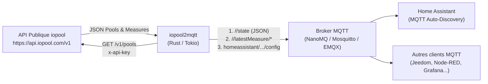

# iopool2mqtt

[](.github/workflows/ci.yml)
[](.github/workflows/security.yml)

**`iopool2mqtt`** est un pont léger, rapide et sécurisé écrit en **Rust** permettant d'interroger l'[API publique iopool](https://help.iopool.com/fr/articles/5537423-api-publique-iopool) pour une ou plusieurs piscines/spas (sonde connectée **EcO**) et de publier l'ensemble des mesures et recommandations vers un broker **MQTT**, avec support natif de la **découverte automatique Home Assistant (MQTT Auto-Discovery)**.

---

## ✨ Fonctionnalités

- **Support multi-bassins** : Récupère automatiquement toutes les piscines associées à votre compte (`/v1/pools`) ou cible uniquement une liste d'identifiants spécifiques (`/v1/pool/{id}`).
- **Double publication MQTT** :
  1. **Payload JSON complet** par bassin sur `<MQTT_BASE_TOPIC>/<pool_id>/state` (ainsi que la liste globale sur `<MQTT_BASE_TOPIC>/pools`).
  2. **Sous-topics individuels** pour chaque métrique (`latestMeasure/temperature`, `latestMeasure/ph`, `latestMeasure/orp`, `advice/filtrationDuration`, `hasAnActionRequired`, etc.).
- **Home Assistant MQTT Auto-Discovery** : Crée automatiquement l'appareil `iopool <Titre>` dans Home Assistant avec tous ses capteurs (`sensor`) et capteurs binaires (`binary_sensor`), leurs unités (`°C`, `mV`, `h`), classes d'appareils et icônes.
- **Disponibilité (LWT)** : Publie `online` / `offline` sur `<MQTT_BASE_TOPIC>/bridge/state` avec gestion du *Last Will and Testament* MQTT.
- **Mode Daemon ou One-Shot** : Fonctionne en boucle continue avec intervalle configurable (`POLL_INTERVAL_SECS=300`) ou en exécution unique (`RUN_ONCE=true`) idéale pour un cron/job Kubernetes.
- **100% Conteneurisé & Sécurisé** : Image Docker multi-stage minimale tournant sous un utilisateur non-root, TLS via `rustls` (sans dépendance OpenSSL), `#![forbid(unsafe_code)]`, et masquage automatique des secrets dans les logs.

---

## 🏗️ Architecture



---

## 🚀 Démarrage rapide

### 1. Configuration (`.env`)

Copiez le fichier [`.env.example`](.env.example) vers `.env` et renseignez au minimum votre clé d'API iopool (`IOPOOL_API_KEY`, disponible tout en bas des paramètres de l'application mobile iopool) :

```bash
cp .env.example .env
```

> **Note** : Toutes les variables présentes dans `.env` peuvent être surchargées à l'exécution via des variables d'environnement système (`docker run -e ...` ou section `environment:` de `docker-compose.yml`).

### 2. Lancement avec Docker Compose (inclut NanoMQ)

Un fichier [`docker-compose.yml`](docker-compose.yml) prêt à l'emploi démarre un broker MQTT **NanoMQ** (`emqx/nanomq:latest`) ainsi que **`iopool2mqtt`** :

```bash
# Démarrer en arrière-plan (mode daemon)
docker compose up -d --build

# Suivre les logs d'iopool2mqtt
docker compose logs -f iopool2mqtt
```

Pour tester en mode **exécution unique** (`RUN_ONCE=true`) :

```bash
RUN_ONCE=true docker compose up --build
```

### 3. Observer les messages MQTT publiés via NanoMQ

Vous pouvez souscrire à l'ensemble des topics publiés directement via le client CLI intégré au conteneur `nanomq` :

```bash
# Observer tous les topics iopool2mqtt
docker exec -it nanomq nanomq_cli sub -h 127.0.0.1 -p 1883 -t "iopool2mqtt/#" -v

# Observer les configurations Home Assistant Auto-Discovery
docker exec -it nanomq nanomq_cli sub -h 127.0.0.1 -p 1883 -t "homeassistant/#" -v
```

---

## ⚙️ Variables d'environnement

Toutes les options sont configurables par variables d'environnement (ou via le fichier `.env`) :

| Variable | Obligatoire | Défaut | Description |
| :--- | :---: | :--- | :--- |
| `IOPOOL_API_KEY` | **Oui** | — | Clé d'accès personnelle à l'API iopool (`x-api-key`). |
| `IOPOOL_API_URL` | Non | `https://api.iopool.com/v1` | URL de base de l'API publique iopool. |
| `IOPOOL_POOL_IDS` | Non | *(vide)* | Liste d'IDs de bassins séparés par des virgules. Si vide, interroge `/v1/pools` pour récupérer tous les bassins. |
| `IOPOOL_HTTP_TIMEOUT_SECS` | Non | `15` | Timeout HTTP (en secondes) pour les appels à l'API iopool. |
| `MQTT_HOST` | Non | `localhost` | Nom d'hôte ou adresse IP du broker MQTT (`nanomq` sous Docker Compose). |
| `MQTT_PORT` | Non | `1883` | Port TCP du broker MQTT. |
| `MQTT_USERNAME` | Non | *(vide)* | Nom d'utilisateur MQTT (optionnel). |
| `MQTT_PASSWORD` | Non | *(vide)* | Mot de passe MQTT (optionnel). |
| `MQTT_CLIENT_ID` | Non | `iopool2mqtt` | Identifiant client MQTT utilisé lors de la connexion. |
| `MQTT_BASE_TOPIC` | Non | `iopool2mqtt` | Préfixe racine des topics MQTT publiés. |
| `MQTT_QOS` | Non | `1` | Niveau de QoS MQTT : `0` (*AtMostOnce*), `1` (*AtLeastOnce*), ou `2` (*ExactlyOnce*). |
| `MQTT_RETAIN` | Non | `true` | Active le flag `retain` sur les états et métriques publiés (`true`/`false`). |
| `MQTT_KEEP_ALIVE_SECS` | Non | `30` | Intervalle de keep-alive MQTT en secondes. |
| `HA_DISCOVERY_ENABLED` | Non | `true` | Active la publication des topics Home Assistant MQTT Auto-Discovery (`true`/`false`). |
| `HA_DISCOVERY_PREFIX` | Non | `homeassistant` | Préfixe des topics de découverte Home Assistant. |
| `POLL_INTERVAL_SECS` | Non | `300` | Intervalle en secondes entre deux interrogations de l'API en mode daemon. |
| `RUN_ONCE` | Non | `false` | Si `true`, effectue une seule synchronisation puis quitte proprement. |
| `RUST_LOG` | Non | `info,iopool2mqtt=info` | Niveau de détail des logs (`trace`, `debug`, `info`, `warn`, `error`). |

---

## 📡 Structure des Topics MQTT publiés

En supposant `MQTT_BASE_TOPIC=iopool2mqtt` et un bassin d'identifiant `<pool_id>` (ex: `cfd5a936-e8e6-4ad3-b985-512bee0d9ad9`) :

### 1. Topics globaux

| Topic | Format | Exemple de Payload | Description |
| :--- | :--- | :--- | :--- |
| `iopool2mqtt/bridge/state` | String | `online` / `offline` | État de connexion du pont (géré via Last Will & Testament). |
| `iopool2mqtt/pools` | JSON Array | `[{"id":"cfd5...","title":"Piscine",...}]` | Tableau JSON complet retourné par l'API pour tous les bassins. |

### 2. Topics par piscine (`iopool2mqtt/<pool_id>/...`)

| Topic | Format | Exemple de Payload | Description |
| :--- | :--- | :--- | :--- |
| `iopool2mqtt/<pool_id>/state` | JSON Object | `{"id":"...","title":"Piscine",...}` | Objet JSON complet du bassin (utilisé aussi par HA Discovery). |
| `iopool2mqtt/<pool_id>/id` | String | `cfd5a936-e8e6-4ad3-b985-512bee0d9ad9` | Identifiant unique du bassin. |
| `iopool2mqtt/<pool_id>/title` | String | `Piscine` | Nom du bassin. |
| `iopool2mqtt/<pool_id>/mode` | String | `STANDARD` | Mode actuel du bassin (`STANDARD`, `OPENING`, `WINTER`...). |
| `iopool2mqtt/<pool_id>/hasAnActionRequired` | Boolean | `true` | Indique si une action d'entretien est requise. |
| `iopool2mqtt/<pool_id>/salt` | Scalar / JSON | `null` | Informations sur le taux de sel (si applicable). |
| `iopool2mqtt/<pool_id>/advice` | JSON Object | `{"filtrationDuration":2}` | Objet JSON des recommandations. |
| `iopool2mqtt/<pool_id>/advice/filtrationDuration` | Number | `2` | Durée de filtration quotidienne recommandée (en heures). |
| `iopool2mqtt/<pool_id>/latestMeasure` | JSON Object | `{"temperature":16.02,...}` | Objet JSON de la dernière mesure EcO. |
| `iopool2mqtt/<pool_id>/latestMeasure/temperature` | Number | `16.025036640276937` | Température de l'eau (°C). |
| `iopool2mqtt/<pool_id>/latestMeasure/ph` | Number | `8.351476506360877` | Niveau de pH de l'eau. |
| `iopool2mqtt/<pool_id>/latestMeasure/orp` | Number | `741` | Potentiel d'oxydo-réduction / Redox (mV). |
| `iopool2mqtt/<pool_id>/latestMeasure/mode` | String | `gateway` | Mode de remontée de la mesure (`gateway`, `standard`, etc.). |
| `iopool2mqtt/<pool_id>/latestMeasure/isValid` | Boolean | `true` | Validité de la mesure. |
| `iopool2mqtt/<pool_id>/latestMeasure/ecoId` | String | `0C6rTwUH` | Identifiant de la sonde EcO. |
| `iopool2mqtt/<pool_id>/latestMeasure/gatewayCode` | String | `I20-98cdaceb5d60` | Code de la passerelle Wi-Fi iopool. |
| `iopool2mqtt/<pool_id>/latestMeasure/measuredAt` | ISO-8601 | `2026-10-23T09:08:00.000Z` | Date et heure UTC de la mesure. |

### 3. Entités Home Assistant Auto-Discovery (`HA_DISCOVERY_ENABLED=true`)

Lorsque la découverte automatique est activée, `iopool2mqtt` publie les configurations retenues suivantes (regroupées sous l'appareil **`iopool <title>`**) :

- `homeassistant/sensor/iopool_<pool_id>_temperature/config` (°C, `device_class: temperature`)
- `homeassistant/sensor/iopool_<pool_id>_ph/config` (`device_class: ph`)
- `homeassistant/sensor/iopool_<pool_id>_orp/config` (mV, `device_class: voltage`)
- `homeassistant/sensor/iopool_<pool_id>_filtration_duration/config` (h, `device_class: duration`)
- `homeassistant/sensor/iopool_<pool_id>_mode/config`
- `homeassistant/sensor/iopool_<pool_id>_measure_mode/config` (*diagnostic*)
- `homeassistant/sensor/iopool_<pool_id>_measured_at/config` (`device_class: timestamp`, *diagnostic*)
- `homeassistant/sensor/iopool_<pool_id>_eco_id/config` (*diagnostic*)
- `homeassistant/sensor/iopool_<pool_id>_gateway_code/config` (*diagnostic*)
- `homeassistant/binary_sensor/iopool_<pool_id>_action_required/config` (`device_class: problem`)
- `homeassistant/binary_sensor/iopool_<pool_id>_measure_valid/config` (*diagnostic*)

---

## 🛠️ Développement, Tests & Qualité (100% via Docker)

Aucune installation locale de Rust n'est requise sur la machine hôte : toutes les commandes de compilation, de formatage, de linting et de test peuvent être exécutées via l'image officielle `rust:1-bookworm`.

### Formater le code (`rustfmt`)
```bash
docker run --rm -v "$PWD":/app -w /app rust:1-bookworm \
  sh -c "rustup component add rustfmt && cargo fmt --all -- --check"
```

### Analyser le code (`clippy`)
```bash
docker run --rm -v "$PWD":/app -w /app rust:1-bookworm \
  sh -c "rustup component add clippy && cargo clippy --all-targets --all-features -- -D warnings"
```

### Lancer les tests unitaires et d'intégration
```bash
docker run --rm -v "$PWD":/app -w /app rust:1-bookworm \
  cargo test --all-targets --all-features
```

### Tester l'API iopool directement avec `curl`
```bash
set -a && source .env && set +a
curl -sS -H "x-api-key: $IOPOOL_API_KEY" https://api.iopool.com/v1/pools/
```

---

## 🔒 CI/CD & Sécurité (GitHub Actions)

Deux workflows GitHub Actions valident automatiquement chaque commit et Pull Request :

1. **[`.github/workflows/ci.yml`](.github/workflows/ci.yml)** :
   - Vérification du formatage (`cargo fmt --check`).
   - Analyse statique stricte (`cargo clippy -- -D warnings`).
   - Génération de la documentation (`cargo doc`).
   - Tests unitaires, doctests et tests d'intégration de bout en bout avec un service broker **NanoMQ** (`emqx/nanomq:latest`).
   - Construction et smoke-test de l'image Docker multi-stage.
2. **[`.github/workflows/security.yml`](.github/workflows/security.yml)** :
   - **`cargo-audit`** : Vérification des vulnérabilités connues dans les dépendances Rust (RustSec Advisory Database).
   - **`cargo-deny`** : Validation des licences open-source autorisées, des sources de crates et des avis de sécurité via [`deny.toml`](deny.toml).
   - **Trivy (Filesystem & Secret Scan)** : Détection de fuites de secrets, d'erreurs de configuration et de vulnérabilités.
   - **Trivy (Container Image Scan)** : Analyse de sécurité de l'image Docker finale (`CRITICAL`, `HIGH`).
